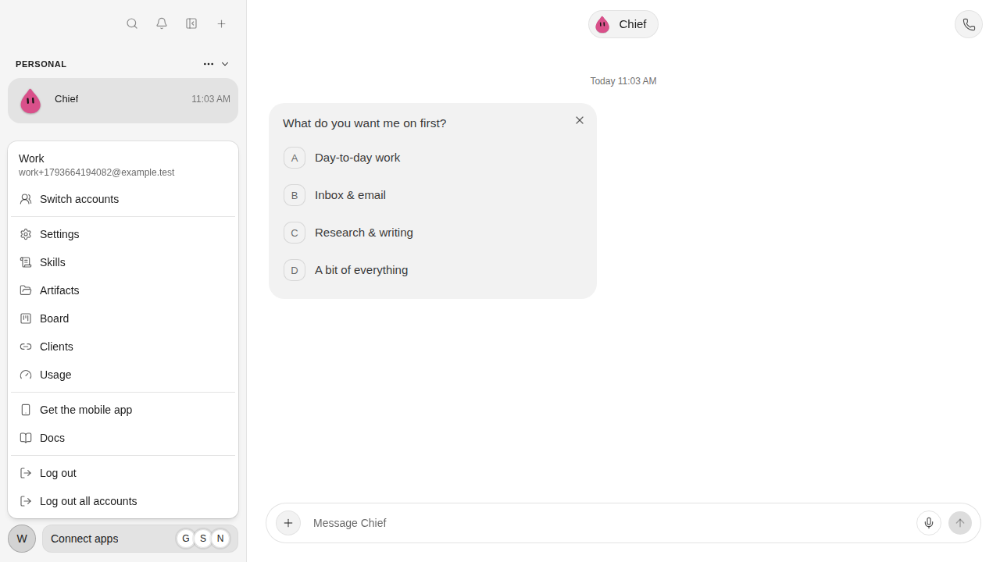
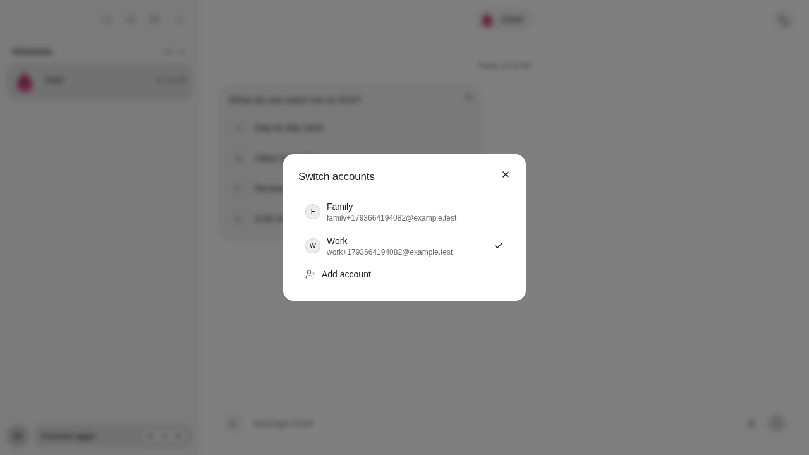
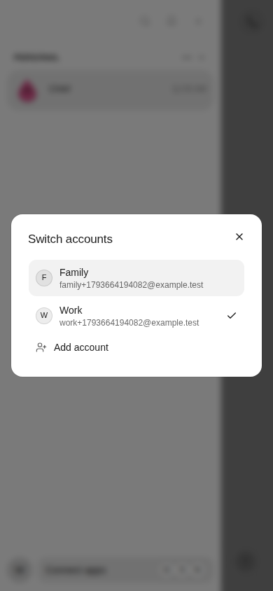
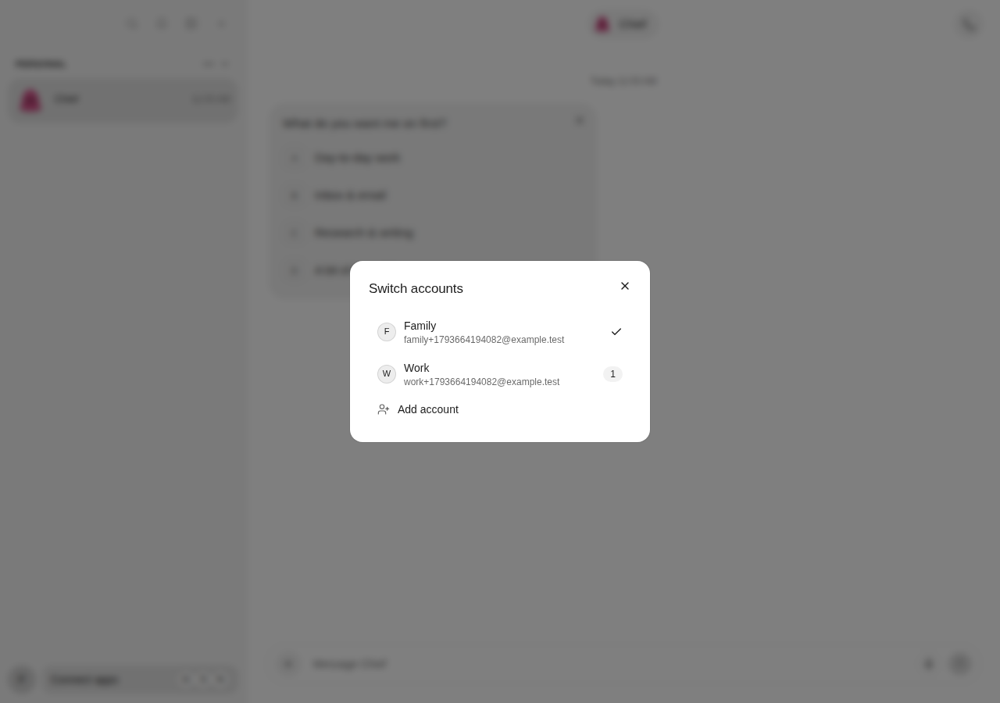
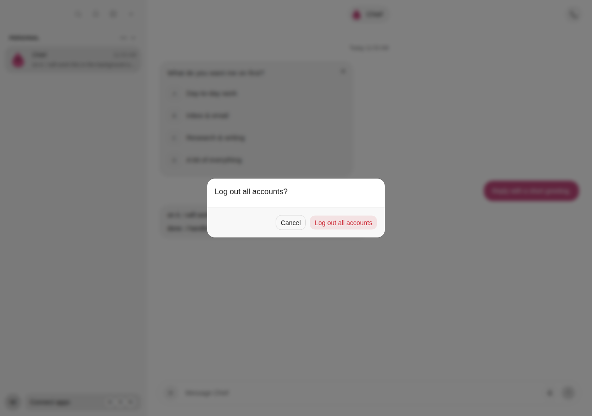

# Multi-account dogfooding evidence

Review captures for [the multi-account implementation](https://github.com/elie222/rakazo/pull/3123).
This branch has independent history and targets an empty orphan base. The draft
can be closed after review without merging evidence into the application.

These screenshots show the browser journey at feature revision `a800b0dc8b01486a0124ed06999129896275347c`,
which combines upstream `28e1ba52c`, the maintainer's published cleanup through
`c3e00c0d0`, and the account picker. They use fictional accounts against an
isolated API. No production services or private account data were used.

## Account menu

The current identity stays visible. The account list and Add account action open
only after selecting “Switch accounts”.

## Desktop account picker

The picker retains account avatars, names, emails, unread counts and the selected
checkmark from the maintainer's layout.

## Phone-width browser picker

This is a responsive browser capture, not a native mobile screenshot.

## Hidden-account unread count

Receiving another account's notification leaves the current account displayed.
Tapping verifies and selects the owning saved account before opening its chat.

## Sign out all confirmation

Cancelling preserves both saved logins. Confirming removes both sessions.

## Verification

The real browser journey passed for adding and switching accounts, unread counts,
hidden-account notification routing, tab refresh, stale-request rejection and
independent/all-account sign-out. Focused unit tests, three PostgreSQL suites,
workspace typechecks, lint and the web production build also passed. The final
PostgreSQL run passed 57 tests, including legacy API unregisters and token rotation.

The full unit run at consolidation revision `41a508e83` passed 20,268 tests and skipped 737; three shell/backup tests
failed in the same way already reproduced on unchanged baseline source. The first
final browser run hit Chromium ERR_NETWORK_CHANGED during module loading while
the full suite ran; the isolated retry passed in 42.7 seconds. After the review follow-up, 383 focused
tests, the seven-test PostgreSQL account-feed suite, workspace typechecks and lint
passed. The final real browser journey passed in 43.0 seconds.

Physical-device push delivery, native compilation and the iOS screenshot flow
remain unverified. Each browser account poll scans up to 500 recent events and
returns up to 50 eligible notices from the past 24 hours. Older eligible alerts
beyond the scan can be omitted. This evidence does not cover the maintainer's additional
unpublished rewrite; integrating that pass needs a published ref.

## Deployment handoff

The feature branch is `feat/multi-account-notifications`. The reported deployed
revision `de8b7a890e4804831baa5b57e276a09a4f191981` is an ancestor: this patch also
includes intervening upstream changes. It is not a patch limited to that release.

The migration adds and backfills `push_registrations`, retaining `push_tokens`
and synchronizing legacy unregisters and rotations during API overlap. Deploy
both API and worker with the configured auth origin. Full multi-account delivery
requires the new worker; old workers can represent only one owner per shared
device token. Roll back application code while retaining the additive database
objects. Native Android polling changes require a rebuilt binary.

The [original implementation plan](https://github.com/christso/rakazo/blob/664c4dc8771e5db991e81ca1f3e1dafb7f1e7667/docs/plans/2026-11-02-1929-feat-multi-account-notifications-plan.md)
remains in history; the maintainer removed its tracked copy during consolidation.

This draft contains no application code or workflow configuration. It is for
review and closure, not merge or deployment.
